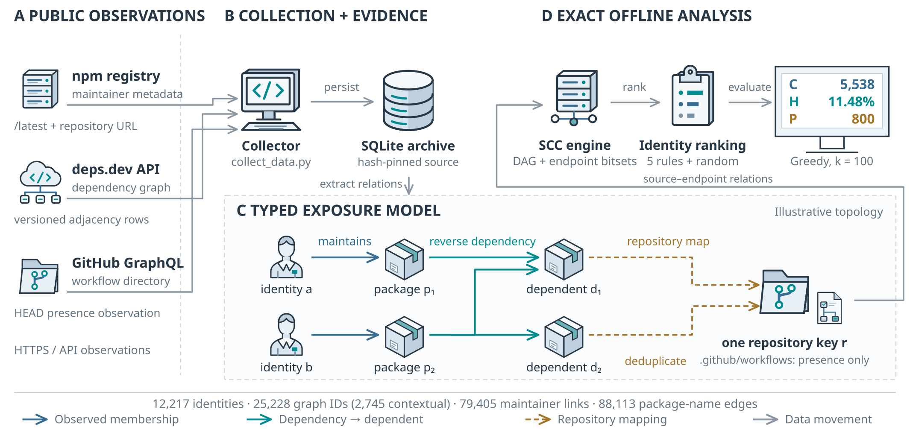
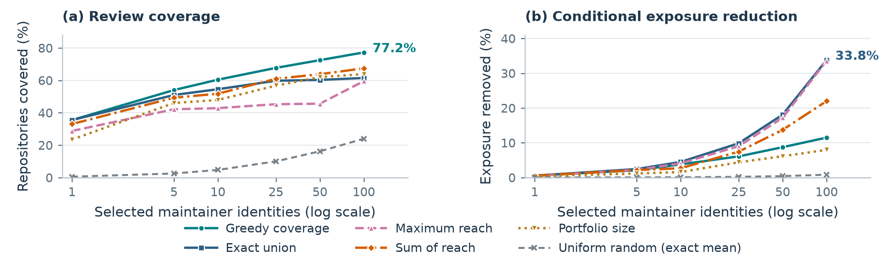
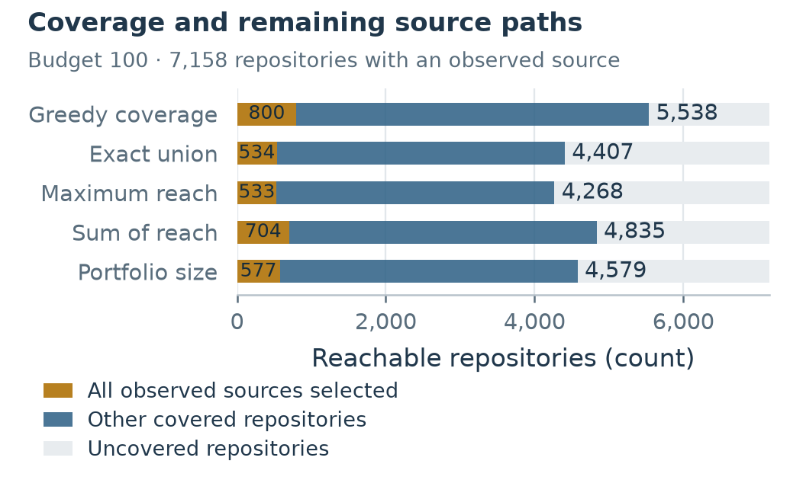
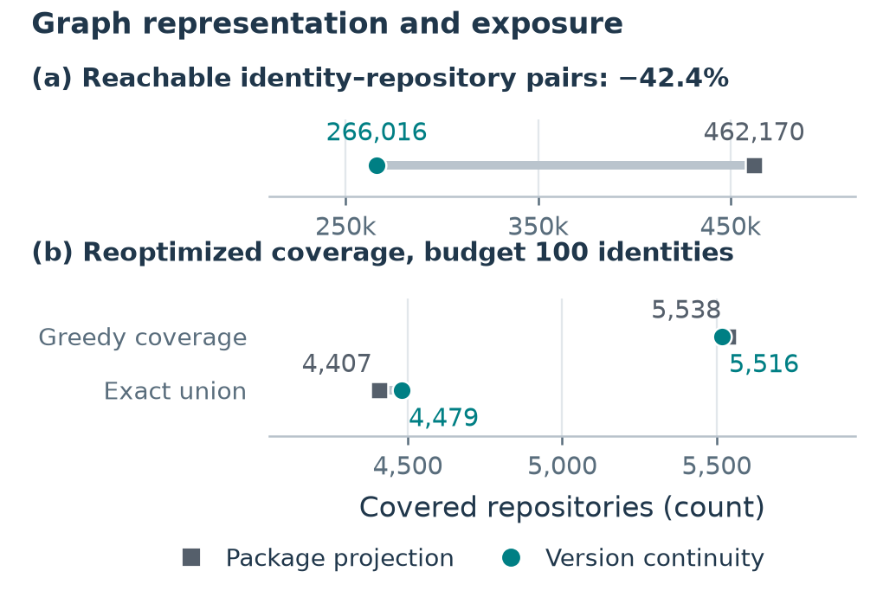

# Research figures

The current manuscript uses four code-generated vector figures. The renderers read our frozen experiment outputs; no image-generation service, stock illustration, external image asset, or network request is used. PDF is the typesetting format, SVG is editable vector source, and PNG is a 300-dpi preview.

| Paper figure | Files | What it explains | Numerical source |
|---|---|---|---|
| 1. Implemented study system | [PDF](study_system.pdf) · [SVG](study_system.svg) · [PNG](study_system.png) | Observations, typed graph, exact reach, budget selection and C/H/P evaluation | Population counts in the structural results and identifier-scope census; miniature graph is explicitly schematic |
| 2. Objective tradeoffs | [PDF](objective_tradeoff.pdf) · [SVG](objective_tradeoff.svg) · [PNG](objective_tradeoff.png) | Coverage and conditional exposure at six budgets, with five methods and the exact random expectation | `deterministic_curves` and `random_analytic_expectations` in the structural results |
| 3. Covered and remaining sources | [PDF](coverage_partition.pdf) · [SVG](coverage_partition.svg) · [PNG](coverage_partition.png) | All-source exclusion P, other covered repositories C−P, and repositories outside coverage | Budget-100 rows; bars conserve the 7,158 source-reachable repositories and exclude 13 without observed sources |
| 4. Representation sensitivity | [PDF](representation_detail.pdf) · [SVG](representation_detail.svg) · [PNG](representation_detail.png) | Total pair mass and reoptimized coverage under package projection and version continuity | Exact pair totals and within-representation budget-100 rows |
| Optional explanation | [PDF](objective_mechanism.pdf) · [SVG](objective_mechanism.svg) · [PNG](objective_mechanism.png) | A six-endpoint counterexample explaining why C, H and P differ | Computed from the declared illustrative exposure sets; this is not an observed npm subgraph |

Regenerate all five figure sets and the numeric paper tables from the repository root:

```bash
MPLCONFIGDIR=/tmp/npm-research-mpl python3 manuscript/scripts/render_research_figures.py
python3 manuscript/scripts/verify_manuscript.py
```

The two focused renderers can also run independently:

```bash
python3 manuscript/scripts/render_system_figures.py
python3 manuscript/scripts/render_analysis_figures.py
```

The complete command also records [figure_manifest.json](../results/figure_manifest.json): source-result hashes, renderer hashes, export hashes, software versions and which figures appear in the paper. [system_figure_data.json](../results/system_figure_data.json) stores measured counts and the illustrative set definitions; [analysis_figure_data.json](../results/analysis_figure_data.json) stores the exact plotted rows and endpoint partitions. After running a focused renderer, rerun the complete command to refresh the combined manifest.

The distinction between diagram and measurement matters: relation arrows describe structural exposure, observed maintainer links do not establish publishing authority, and workflow association does not establish execution. H assumes a fixed equal-account prior and perfect prevention of a selected source scenario. P counts all-source exclusion within that model; its gold segment is not a measured count of incidents prevented. The version graph remains an observed union, not an installed tree or historical ground truth.

Earlier `review_coverage`, `representation_sensitivity`, `artifact_comparison`, `weight_sensitivity` and `evidence_pipeline` assets are retained as historical analysis graphics; the current manuscript references the four figures above.

## System overview



## Measured tradeoff



## Covered repositories and remaining sources



## Representation effects


